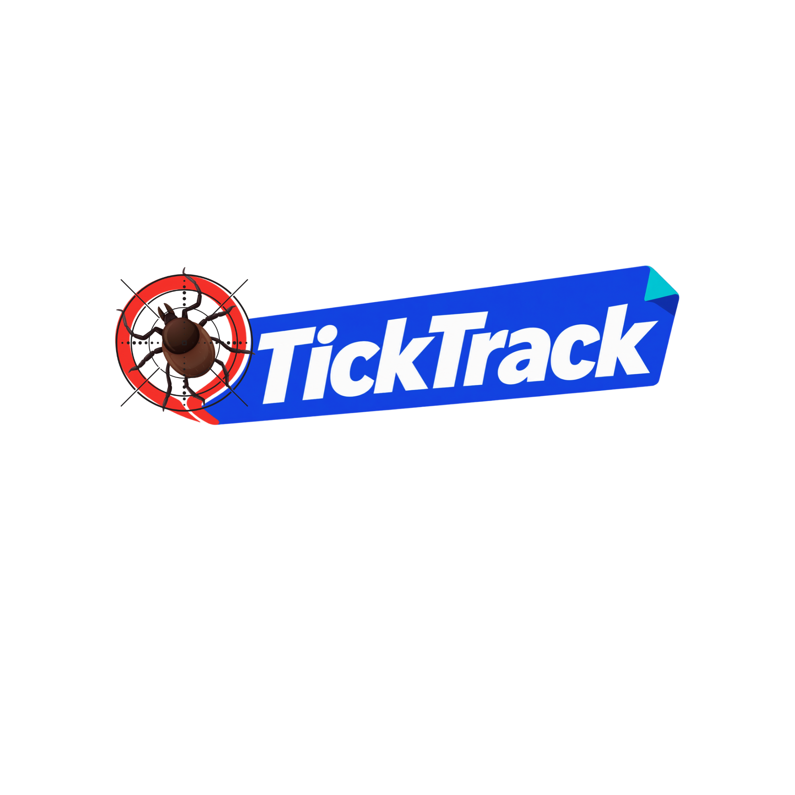
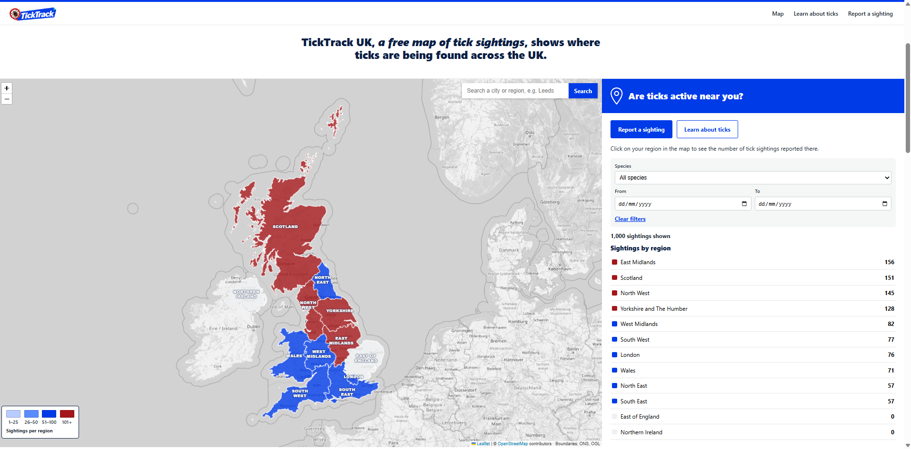
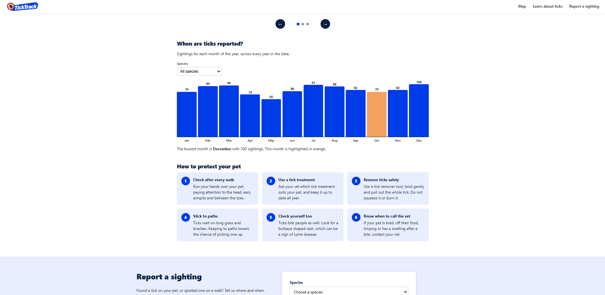
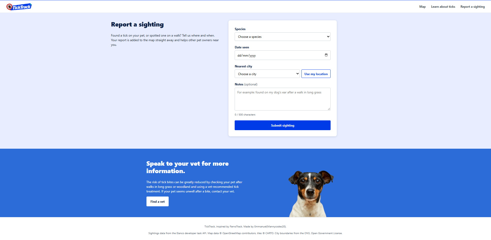
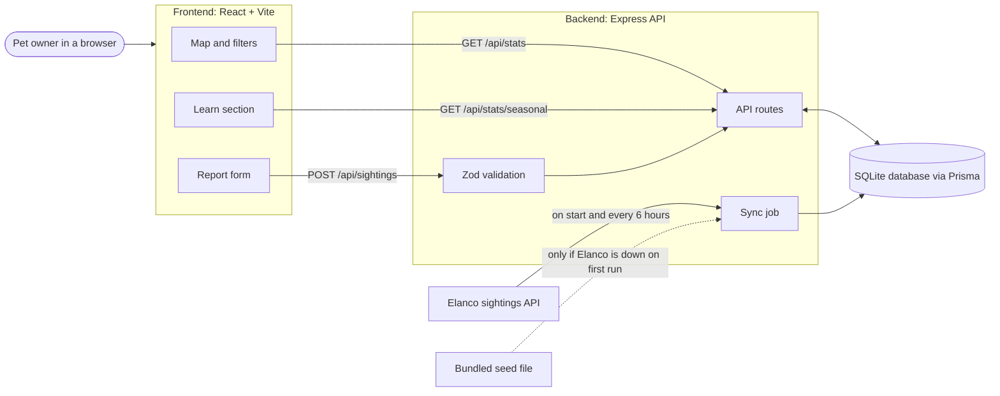
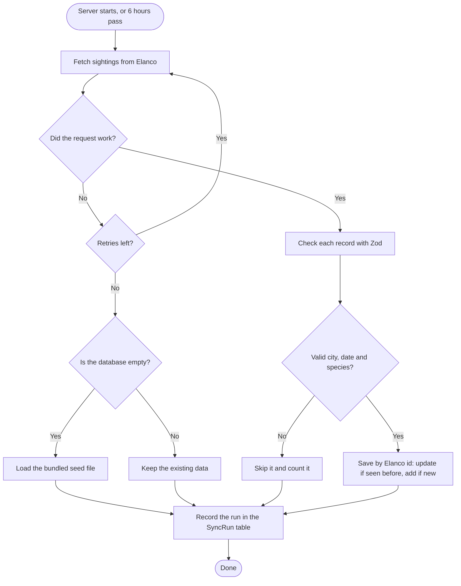
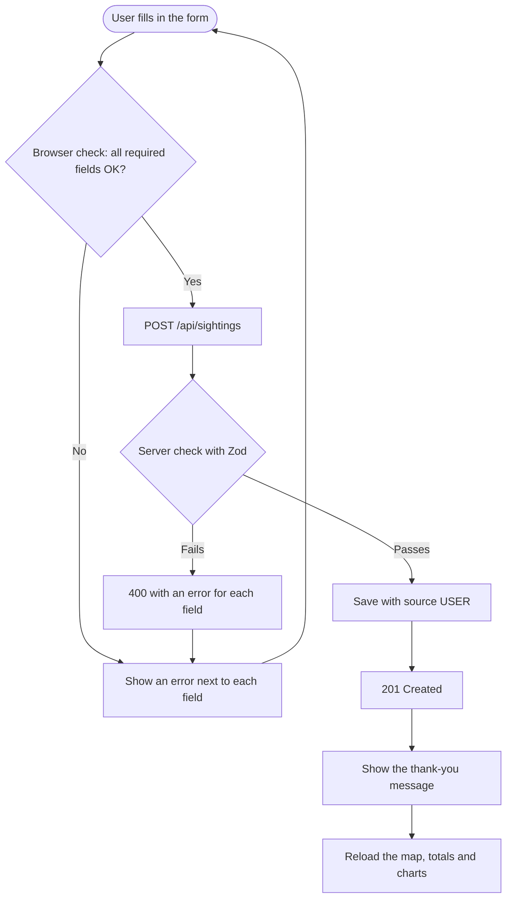
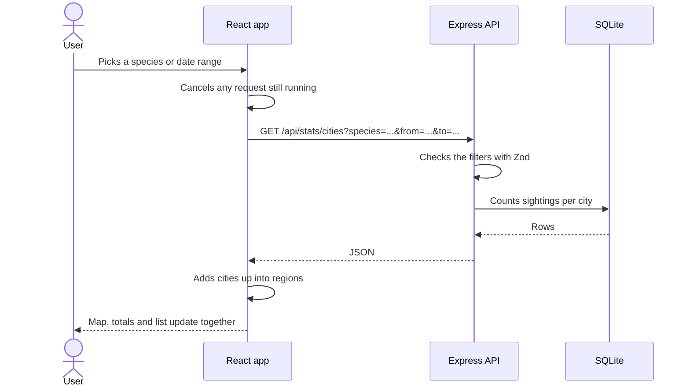
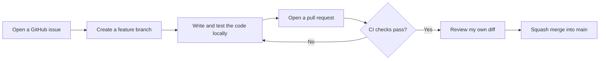

<p align="center">
  
</p>

# TickTrack UK

**A free map of tick sightings that shows pet owners where ticks are being found across the UK.**

I built TickTrack UK for the Elanco Placement Programme 2026 full stack technical task. It takes Elanco's tick sighting data, keeps it in its own database, and turns it into a map, a guide to the five tick species, and a form where anyone can report a tick they've found. The layout is inspired by Elanco's ParvoTrack.

**Made by:** Emmanuel [SURNAME] ([@mannycodes20](https://github.com/mannycodes20))
**Video walkthrough:** [LINK TO VIDEO]

> TickTrack UK is a student project. It is not an official Elanco product.



## Contents

- [Features](#features)
- [How to use TickTrack UK](#how-to-use-ticktrack-uk)
- [Tech stack](#tech-stack)
- [Tools I used](#tools-i-used)
- [How it works](#how-it-works)
- [API reference](#api-reference)
- [Running it on your machine](#running-it-on-your-machine)
- [How I worked](#how-i-worked)
- [Use of AI](#use-of-ai)
- [What I'd do next](#what-id-do-next)
- [Credits](#credits)

## Features

### The map
- The UK's 12 regions are shaded by how many sightings they have: light blue for 1 to 25, mid blue for 26 to 50, dark blue for 51 to 100 and red for over 100. A legend in the corner explains the colours.
- The side panel shows how many sightings match your filters and ranks every region from most to fewest.
- Filter by **species** and by a **date range**. The map, totals and region list all update together.
- A **search box** finds a city or region, for example "Leeds", and flies the map to it.

### Sighting information
- Click a region to see its total, its risk level, the cities in it and a **timeline** of sightings per year, with the busiest year picked out.
- Click a city to see its 20 most recent sightings, with species, date, notes and whether each one came from Elanco or a user.
- The **Share** button opens your phone's share menu, or copies a link on a laptop. Opening that link takes you straight back to the same region or city.

### Learn about ticks
- A **species guide** carousel covers the five species in the data, with Latin names, where they live, what they feed on and how risky they are for pets. Each card has a "Show on map" button.
- A **seasonal chart** shows sightings for each month of the year, with its own species filter. The busiest month is highlighted in orange.
- Six **tips** explain how to protect your pet, ending with when to call the vet.



### Report a sighting
- A short form asks for species, date, nearest city and optional notes.
- **Use my location** picks the nearest city for you (UK only).
- Mistakes are caught in the browser and again on the server, and each error message appears next to the field it's about.
- When you submit, a thank-you message appears and your sighting is added to the map and totals straight away.



### Accessibility
- A "Skip to main content" link for keyboard users.
- Every field has a label, and screen readers announce errors and changing totals.
- The region list works with the keyboard and shows a clear focus outline.
- The map stops animating if your device is set to reduce motion.
- The layout works on phones, tablets and tall portrait screens.

## How to use TickTrack UK

**1. See what's happening across the UK.** When the page opens, the map shows every sighting in the data. Red regions have the most. The list on the right ranks the regions, so you can see the busiest at a glance.

**2. Narrow it down.** Pick a species from the **Species** menu, or set **From** and **To** dates to look at one period, such as last summer. The map recolours and the totals change to match. **Clear filters** puts everything back.

**3. Find your area.** Type your city or region into the search box at the top of the map, for example "Sheffield", and press **Search**. The map zooms in for you. You can also just click a region on the map or in the list.

**4. Look closer.** With a region open, the panel shows its risk level, its cities and a timeline of sightings per year. Click a city to read its latest sightings one by one. Press **Back** to return to the UK view.

**5. Share it.** Press **Share** to send a link to that region or city to a friend, your vet or a dog walking group.

**6. Learn about ticks.** Press **Learn about ticks** in the top menu. Use the arrows to move through the species cards, and press **Show on map** on any card to see only that species. Below that, the chart shows which months are busiest, and the tips explain how to protect your pet.

**7. Report a tick.** Press **Report a sighting**. Choose the species, the date and your nearest city (or press **Use my location**), add a note if you like, and press **Submit sighting**. Your sighting shows on the map straight away.

## Tech stack

| Part | What I used | Why I chose it |
|---|---|---|
| Frontend | **React 19** with **TypeScript**, built with **Vite** | React lets me keep each feature in its own component. TypeScript catches mistakes while I type instead of in the browser, and Vite reloads changes almost instantly. |
| Map | **Leaflet** with **react-leaflet**, OpenStreetMap tiles | Leaflet is free and open source, and OpenStreetMap needs no API key or account. Region outlines are GeoJSON, which Leaflet can shade directly. |
| Charts | Plain HTML and CSS | The seasonal chart and timeline are simple bars, so I didn't add a chart library. This keeps the site small and fully under my control. |
| Backend | **Node.js** with **Express 5** and TypeScript | The same language on both sides means I only need one set of habits. Express is small, well documented and easy to read. |
| Database | **SQLite** through **Prisma 6** | SQLite is a single file, so there's no database server to install. Prisma gives typed queries and migrations, and moving to PostgreSQL later is a one line change. |
| Validation | **Zod 4** | One set of rules checks query strings, form submissions and Elanco's records, and produces clear error messages for each field. |
| Security | **helmet** and **cors** | helmet sets safe HTTP headers, and cors controls which sites can call the API. |
| CI | **GitHub Actions** | Every pull request runs the database migration, type checks and smoke tests the API, then lints and builds the frontend. Nothing reaches `main` unless it passes. |

## Tools I used

| Tool | What I used it for |
|---|---|
| VS Code | Writing the code |
| Git and GitHub | Version control, issues, branches and pull requests |
| GitHub Actions | Running the checks on every pull request |
| Postman and the browser | Testing each API endpoint, including the error cases |
| Prisma Studio | Looking at and fixing rows in the database |
| Chrome DevTools | Checking layouts at phone width and watching network requests |
| npm | Installing packages and running scripts |
| Claude | A tutor and code reviewer (see [Use of AI](#use-of-ai)) |

## How it works

### The big picture

The browser only ever talks to my own API, never to Elanco directly. The API keeps a copy of Elanco's data in SQLite, so the site stays fast and keeps working even when Elanco's service is down.



### Getting Elanco's data

When the server starts, and every 6 hours after that, a sync job fetches all of Elanco's sightings. Every record is checked before it's saved, so bad data never reaches the map.



A few details worth knowing:

- **No duplicates.** Each sighting is stored with Elanco's own id, so syncing again updates records instead of copying them.
- **Locations.** Elanco gives a city name but no coordinates, so each sighting is placed at its city centre. The frontend groups the 14 cities into the 12 UK regions for the shaded map.
- **User reports are kept separate.** They're saved with `source: "USER"`, so they can always be told apart from Elanco's data, and the sync never touches them.

### Reporting a sighting

The form checks your answers in the browser first, so you get instant feedback. The server checks them again, because anyone can send a request to an API without using the form.



### Using the filters

Every filter change becomes a new request to the API. If you change a filter before the last request has finished, the old one is cancelled, so the map never shows stale numbers.



### Errors

Every error from the API has the same shape, so the frontend handles them all in one place:

```json
{ "error": { "code": "VALIDATION_ERROR", "message": "Invalid query", "details": { "city": "Unknown city" } } }
```

- Bad input returns **400** with a message for each field.
- Unknown routes return a JSON **404**.
- Anything unexpected returns **500** without leaking internal details.

## API reference

| Method | Endpoint | What it returns |
|---|---|---|
| GET | `/api/health` | Status, number of sightings and the last sync |
| GET | `/api/sightings?from=&to=&city=&species=&source=&page=&limit=` | Sightings, newest first, with paging |
| GET | `/api/sightings/:id` | One sighting |
| POST | `/api/sightings` | Saves a new report (`species`, `observedAt`, `city`, optional `notes`, `latitude`, `longitude`) |
| GET | `/api/stats/cities` | Sightings per city, with coordinates and the latest date |
| GET | `/api/stats/trends?interval=week\|month` | Sightings per week or month |
| GET | `/api/stats/seasonal` | Sightings per calendar month across all years |
| GET | `/api/stats/species` | Each species with its Latin name and count |

All the list and stats endpoints accept the same filters. `city` can be one city or several separated by commas, for example `city=Leeds,Sheffield`.

## Running it on your machine

You need **Node.js 22** or newer, and Git.

```bash
git clone https://github.com/mannycodes20/ticktrack-uk.git
cd ticktrack-uk
```

**1. Start the API** (first terminal)

```bash
cd server
npm install
cp .env.example .env        # on Windows: copy .env.example .env
npx prisma migrate deploy   # creates the SQLite database
npm run dev
```

The API runs on http://localhost:3001 and loads Elanco's data within a few seconds.

**2. Start the website** (second terminal)

```bash
cd client
npm install
npm run dev
```

Open http://localhost:5173. Vite forwards anything under `/api` to the server, so there's nothing else to set up.

**Checks**

- In `client`: `npm run lint` and `npm run build`
- In `server`: `npm run typecheck`

## How I worked

I worked the way a team would, even though it was just me, so that every change was planned, checked and easy to trace.



- Each feature (the map, Learn section, report form, timeline and Share) had its own issue and branch.
- I tested every endpoint with Postman and the browser, including the error cases.
- I followed a test plan that checks every requirement in the brief.


## What I'd do next

- **Photo upload** on the report form, stored in cloud storage. The database already has an `imageUrl` column for it.
- **Moderation and rate limiting**, so user reports are checked before they appear publicly.
- **Exact locations**, if Elanco's data included coordinates, so the map could show markers within a city.
- **Region totals from the server**, through a `/api/stats/regions` endpoint.
- **Automated tests** with Vitest and Playwright, run in CI.
- **Dark mode** that follows the device setting.
- **Deployment** with PostgreSQL, for example on Render or Railway.

## Credits

- Tick sighting data: Elanco developer task API
- Map tiles: © [OpenStreetMap](https://www.openstreetmap.org/copyright) contributors
- UK region boundaries: Office for National Statistics, Open Government Licence (via martinjc/UK-GeoJSON)
- Dog photo: Victor G on Unsplash
- Tick photo: Erik Karits on Unsplash
- Layout inspired by Elanco's ParvoTrack
